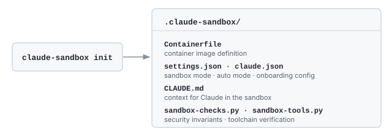
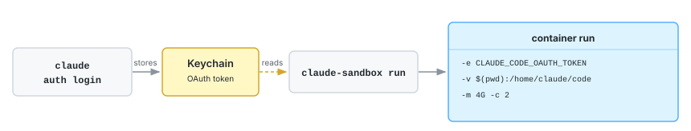

# claude-sandbox

Claude Code is most useful when it can edit files and run commands on its own. You don't want to
give it access to everything on your machine. You also don't want to babysit every action it takes.
`claude-sandbox` is how I balance this for my personal projects. It runs Claude Code in a
lightweight Linux VM (via [Apple Containers][containers] on macOS) with only your project
directory mounted. Claude sees the directory you started it in and nothing else on the host.

Inside the VM, Claude Code's [sandbox mode][sandbox] and [auto mode][permissions] let bash commands
run freely without prompting. As long as work stays local, you never see a permission dialog. If a
command tries to reach a domain that isn't allowlisted, the bubblewrap sandbox triggers a permission
prompt. Most work doesn't need remote content, so most sessions run uninterrupted. There is no
escape hatch. `allowUnsandboxedCommands` is false and `failIfUnavailable` is true, so a bash command
either runs inside bwrap or does not run at all.

Auto mode approves edits as well as sandboxed commands. The two rules `CLAUDE.md` states in prose
therefore need enforcement that does not depend on a prompt appearing. Adding a dependency is an
`ask` rule on both halves of the act. It covers the CLI invocation (`cargo add`, `uv add`,
`pip install`, `npm install`) and a direct edit to a manifest or lock file. Editing `Cargo.toml` and
running `cargo build` adds a dependency just as surely. Leaving git to the host user is a `deny`
rule covering the subcommands that rewrite history, discard work, or reach the network. `git add`
stays available so Claude can still stage what it changed.

In short, `claude-sandbox` runs Claude Code in an isolated Linux VM with sandbox mode and auto mode.
Bash runs freely inside [bubblewrap][bubblewrap], but anything that reaches outside prompts you.

To use it, install with:

```bash
cargo install --git https://github.com/aldrin/claude-sandbox.git
```

### Usage

```
$ claude-sandbox --help
Launch Claude Code in a sandboxed Apple container VM.

Usage: claude-sandbox <COMMAND>

Commands:
  init    Initialize workspace with default Containerfile
  build   Build the sandbox container image
  run     Run Claude Code in the container
  status  Compare .claude-sandbox/ files against the current binary's embedded assets
  help    Print this message or the help of the given subcommand(s)

Options:
  -h, --help     Print help
  -V, --version  Print version
```

Go into a project directory and run `init` to scaffold `.claude-sandbox/`. Run `build` to build the
container image. After that, `run` starts Claude Code inside the container. Use `status` after
upgrading the binary.

Each project gets its own image, named `claude-sandbox-<dirname>` by default. Override that with
`--name` during init. The name lives in `.claude-sandbox/image-name`, and both `build` and `run`
read it. Several sandboxes can run at once.

**`init`** scaffolds `.claude-sandbox/` in your project. The binary embeds every file, so the
directory is disposable and `init --force` rewrites it. It holds the `Containerfile`,
`settings.json`, and a `CLAUDE.md` that orients Claude inside the container. The rest is support:
the two `/verify` scripts and the `/verify` and `/commit` definitions. A `claude.json` answers the
onboarding prompts and a `.gitconfig` supplies a commit identity. Edit the `Containerfile` to add
what your project needs.

<p align="center"></p>

**`build`** builds the container image. Start Apple Containers first with `container system start`.
The first build pulls Claude Code and your tooling, so it takes a few minutes. Rebuild only when you
change the `Containerfile`. A newer binary can ship assets your workspace lacks. The `Containerfile`
copies them, so `build` checks first and names what is missing. It never flags a file you edited.
Only absence matters.

**`run`** launches Claude Code with your project mounted. It reads your OAuth token from the macOS
keychain and passes it as an environment variable. Run `claude auth login` first if you have not
authenticated.

<p align="center"></p>

The container gets 2 CPUs and 4 GB of memory by default. `--cpus` and `--memory` accept 2 through 8.
The container is destroyed on exit.

`run` also passes `--masked-path NONE --read-only-path NONE`. The runtime bind-mounts over procfs
subpaths such as `/proc/kcore` and `/proc/sys` by default, which leaves `/proc` "not fully visible".
The kernel then refuses the fresh proc mount that bubblewrap needs. Every sandboxed command dies
with `bwrap: Can't mount proc on /newroot/proc: Operation not permitted`. Clearing both sets is what
lets the bwrap sandbox start. You give up little. Each container is its own VM, and the `claude`
user is unprivileged, so root-owned entries like `/proc/kcore` stay unreadable.

> **Note:** The token never appears on the command line. `settings.json` denies
> `CLAUDE_CODE_OAUTH_TOKEN` to sandboxed commands, so bash cannot read it. It stays visible
> through `container inspect` on the host.

**`status`** compares each file in `.claude-sandbox/` against the assets embedded in your installed
binary, reporting `ok`, `DIFF`, or `MISS`. A `DIFF` is fine, because the `Containerfile` is meant to
be customized. After a binary upgrade, `status` tells you what has moved.

Inside the container, `/verify` confirms the sandbox is sound. It runs `sandbox-checks.py` for
isolation and `sandbox-tools.py` for the toolchain, then summarizes both. The other bundled command,
`/commit`, drafts a commit message for the staged changes. The isolation half opens with a mount
table and the proxy variables, then checks the invariants.

  ```
  ❯ python3 ~/sandbox-checks.py

  Sandbox overview (from /proc/self/mountinfo + environment)

    ... mount table, proxy variables, PID namespace, mount totals ...

  Outbound network is blocked

    PASS  DNS unreachable: github.com
    PASS  DNS unreachable: pypi.org
    PASS  DNS unreachable: google.com
    PASS  TCP unreachable: GitHub HTTPS (github.com:443)
    PASS  TCP unreachable: GitHub SSH (github.com:22)
    PASS  TCP unreachable: PyPI (pypi.org:443)
    PASS  TCP unreachable: npm (registry.npmjs.org:443)
    PASS  TCP unreachable: Cloudflare DNS (1.1.1.1:53)
    PASS  TCP unreachable: Google DNS (8.8.8.8:53)

  System paths are read-only

    PASS  /etc is read-only
    PASS  /usr is read-only
    PASS  /usr/bin is read-only
    PASS  /var is read-only

  Work paths are writable

    PASS  /home/claude is writable
    PASS  /home/claude/code is writable
    PASS  /home/claude/cargo-target is writable
    PASS  /tmp/claude is writable

  Localhost port binding works

    PASS  bind() to 127.0.0.1:0 succeeds

  Process runs in sandbox

    PASS  SANDBOX_RUNTIME=1

  Allowed traffic is mediated by proxy

    PASS  HTTP_PROXY points to local proxy
    PASS  HTTPS_PROXY points to local proxy
    PASS  ALL_PROXY points to local proxy
    PASS  SSH is routed through proxy

  ────────────────────────────────────────
    Network:     ok    outbound DNS and TCP blocked
    Filesystem:  ok    / read-only, workdir writable
    Localhost:   ok    bind() to 127.0.0.1 works
    Process:     ok    SANDBOX_RUNTIME=1
    Proxy:       ok    HTTP, HTTPS, and SSH via localhost
  ────────────────────────────────────────
  23 passed, 0 failed
  ```

The overview section is informational and never fails. It is there so you can read the mount table
yourself rather than trust the summary. Both scripts also run outside Claude if you override the
entrypoint with `--entrypoint /bin/bash`.

### What's in the container

The container is a workspace for writing and testing code with Claude. The default `Containerfile`
reflects my own toolchain. Edit it to fit yours. `sandbox-tools.py` probes the toolchain, the
installed plugins, and the runtime environment.

  ```
  ❯ python3 ~/sandbox-tools.py

  Development toolchain is available

    PASS  Rust compiler  rustc 1.98.1
    PASS  Cargo  cargo 1.98.1
    PASS  rust-analyzer  rust-analyzer 1.98.1
    PASS  Clippy  clippy 0.1.98
    PASS  rustfmt  rustfmt 1.9.0-stable
    PASS  Python  Python 3.14.4
    PASS  uv  uv 0.12.9
    PASS  basedpyright  basedpyright 1.39.10
    PASS  DuckDB  v1.5.5
    PASS  Pandoc  pandoc 3.9.0.2
    PASS  Typst  typst 0.15.1
    PASS  Emacs  GNU Emacs 30.2
    PASS  ripgrep  ripgrep 15.1.0
    PASS  bubblewrap  bubblewrap 0.11.1

  Plugins are installed and active

    PASS  rust-analyzer-lsp is installed
    PASS  pyright-lsp is installed
    PASS  code-simplifier is installed
    PASS  feature-dev is installed

  Runtime environment is configured

    PASS  CARGO_TARGET_DIR=/home/claude/cargo-target
    PASS  EDITOR=emacs
    PASS  TERM=xterm-256color
    PASS  TMPDIR is under /tmp/claude

  ────────────────────────────────────────
  22 passed, 0 failed
  ```

  Version numbers reflect the container image at build time and may differ from yours.

That list is a spot check, not an inventory. The `Containerfile` also installs a nightly toolchain,
`cargo-fuzz`, `cargo-llvm-cov`, and a C toolchain, none of which the script probes. The plugin
section earns its keep. The `claude plugin install` calls in the `Containerfile` and the
`enabledPlugins` block in `settings.json` must name the same set. Installed but not enabled means
recommendation prompts. Enabled but not installed means errors at startup. Nothing else enforces
that.

### Platform drift

This code is static. The platform under it is not. Everything here tracks latest, so an upgrade to
macOS, the container runtime, the guest kernel, or Claude Code can break isolation without warning.
That has already happened once, which is why `run` clears the masked paths described above. Re-run
`/verify` after upgrading any of them, and read the `/verify` output for the versions you are
actually on.

The guest kernel matters most, because `bwrap` is not setuid. It isolates through unprivileged user
namespaces. A kernel that restricts those takes every bash command down at once, because
`settings.json` sets `failIfUnavailable`. The `Containerfile` explains why the setuid bit is not the
answer.

### Settings

`settings.json` controls the model, permissions, sandbox mode, the status line, and the runtime
environment. Beyond the `ask` and `deny` rules above, it denies the sandbox any read of `~/.ssh`,
`~/.aws`, `~/.config/gcloud`, and `~/.netrc`. It also strips the OAuth token, API keys, and AWS
credentials from the environment sandboxed commands see. None of those belong in the container, but
the mount is a host directory, so the guarantee should not rest on that alone. The `env` block sets
paths and terminal settings. It disables cron, background tasks, auto-memory, and file
checkpointing, which do not apply in an ephemeral container.

The `Containerfile` switches to `USER root` to copy these files in, so they land root-owned. That is
deliberate. The Edit and Write tools do not go through bwrap, so root ownership is what keeps Claude
from rewriting the rules it runs under.

The status line is a `jq` one-liner in `settings.json` that prints the model name and the context
percentage. Claude Code reports context usage on demand through `/usage` and `/context`, but it has
no continuous display. Nothing else earns a place. The branch belongs to the host user, and the
project always mounts at the same container path.

[containers]: https://github.com/apple/container
[sandbox]: https://code.claude.com/docs/en/sandboxing
[permissions]: https://code.claude.com/docs/en/permissions
[bubblewrap]: https://github.com/containers/bubblewrap
